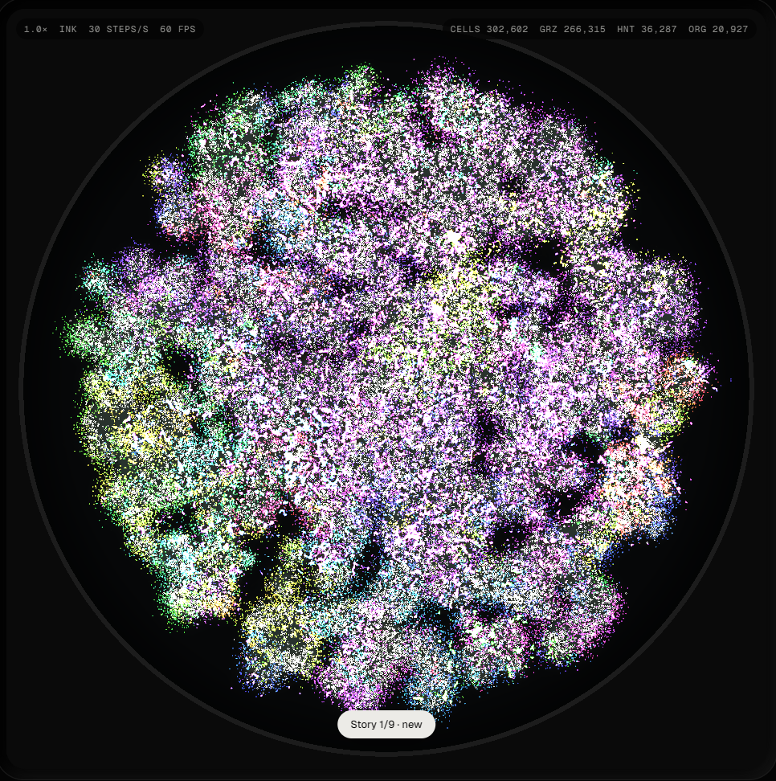
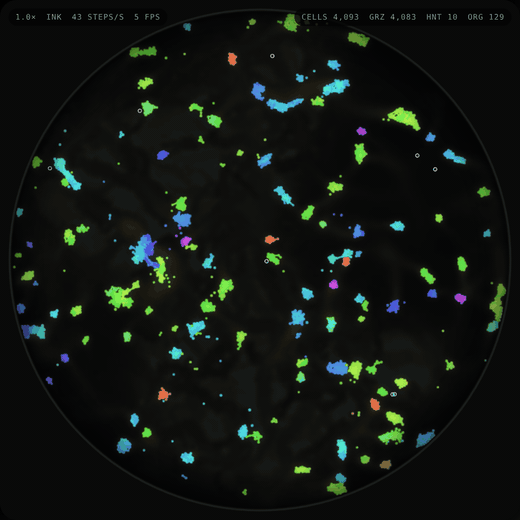
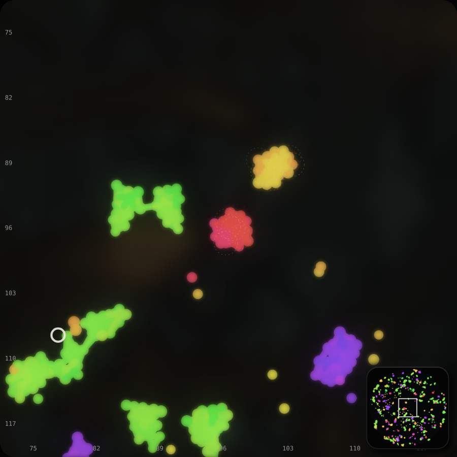
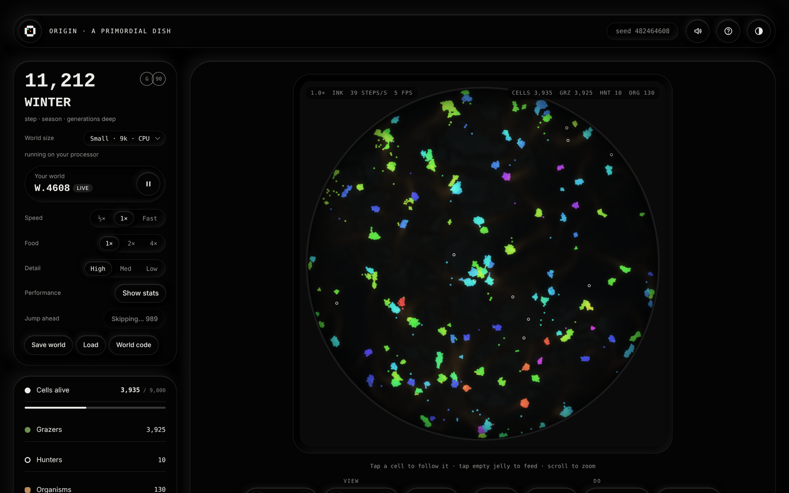

  

<h1 align="center">origin</h1>

<b>a primordial dish</b>

  <a href="https://origindish.net"><b>Try it live at origindish.net</b></a> &nbsp;·&nbsp;
  <a href="https://x.com/OriginDish">@OriginDish on X</a>

---

Origin is a living dish of simple cells, each with its own tiny brain. They eat, move, divide and die. Nothing they do is scripted. Every behaviour you see, from families clumping into bodies to hunters chasing prey, comes from the rules plus evolution.

The picture above is about 300,000 cells running in real time on a single graphics card. Each colour is a family.

  

## What lives in the dish

- **Grazers** eat food that grows in the jelly. Each one is born with a small neural network brain, copied with small changes from its parent.
- **Hunters** are the hollow rings. They eat grazers.
- **Bodies** form when grazers from the same family hold on to each other. Bodies are harder to eat and can fight back.
- **Waste** builds up where cells live and slowly poisons them, so crowding has a cost.
- **Seasons** change how fast food grows back, so good times and hard times come in waves.

  

## Two ways to run it

**In your browser** at [origindish.net](https://origindish.net). Every visitor gets their own world, computed on their own device. Small worlds run on the processor. Large and Huge run on the graphics card.

**As a desktop app** (Windows, private build). It is the same simulation built to push the graphics card as far as it goes: dishes up to about a million cells, drawn directly from the card's memory. On an RTX 3090 it holds 300,000+ living cells at a smooth 60 frames per second.

  

## What I have found so far

- **Bodies need a reason to exist.** Cells only form big bodies because staying next to family earns a small food bonus. Turn the bonus off and almost no bodies form.
- **I tried replacing that bonus with something more realistic.** In "outside digestion", cells leak part of their food to the neighbours they hold on to. Bodies still formed and waste deaths dropped sharply, but the dish held far fewer cells, so I kept the original rules.
- **Bigger bodies sit in their own waste.** It is one of the biggest killers in the dish, and an open question whether cells will evolve to move away from it.
- **Each world is different.** Every new world starts from a random seed. Telling real evolution apart from luck means running the same world many times, which is next on the list.

## Built with

- Plain JavaScript in a single page, with the simulation in a background worker
- WebGPU compute shaders for the big worlds, and WebGPU drawing in the desktop app
- Electron for the Windows desktop build

## Credit

Origin started from the cellular automata and neural-network particle work of **Fraser Price** ([@fraserpricee](https://x.com/fraserpricee)). His project was the spark; Origin takes the idea to a much larger scale.

## About this repository

This repository is a showcase. The source code and the desktop app are not published here. To explore the dish, visit [origindish.net](https://origindish.net).

© 2026 origin. All rights reserved.
